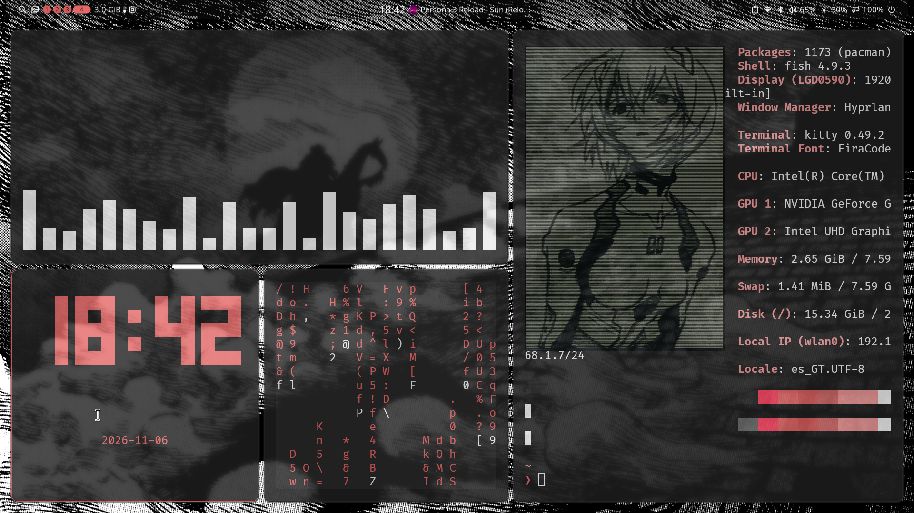
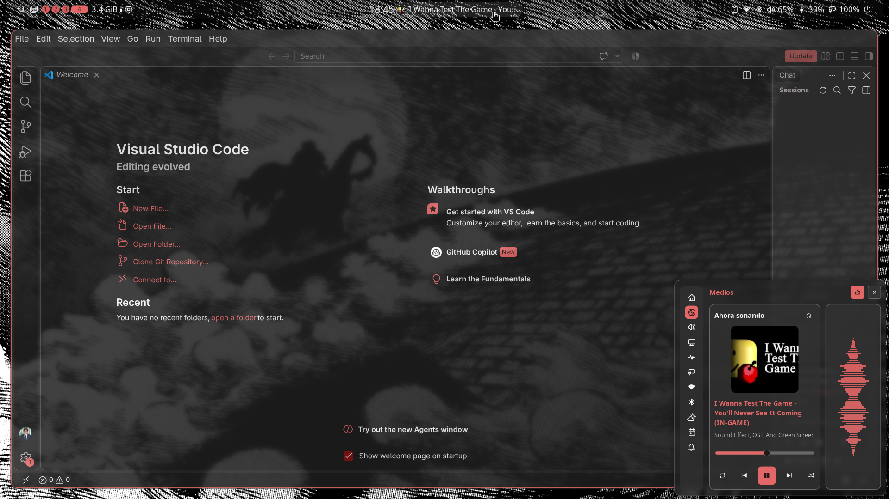
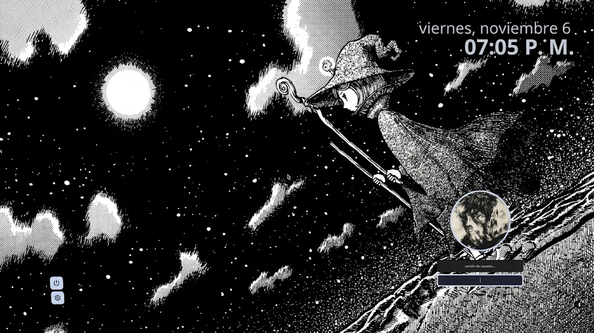

# Dotfiles para CachyOS y Hyprland

Autor: Velasco-c

Configuración y herramientas opcionales para CachyOS/Arch con Hyprland y Noctalia. Hay dos comandos públicos; ambos muestran primero un resumen de los paquetes, archivos que se copiarán y respaldos previstos. Al aceptar cada bloque, el instalador copia los archivos a sus rutas de usuario o del sistema y respalda lo que reemplaza. Los enlaces simbólicos dentro de árboles copiados se materializan como archivos y carpetas, para que la configuración instalada no dependa de la ubicación del repositorio. El dotfile puede borrarse después de instalar.

## Así se ve







## Instalar

Clona el repositorio y entra a su carpeta:

```bash
git clone https://github.com/Velasco-c/Dotfile_Velasco-c.git
cd Dotfile_Velasco-c
```

Instalación personalizada: cada bloque pide confirmación antes de hacer cambios.

```bash
python3 instalar-personalizado.py
```

Instalación completa: acepta todos los bloques automáticamente.

```bash
python3 instalar-completo.py
```

Ambos modos configuran y habilitan SDDM con el tema `corners` para el próximo reinicio. El modo personalizado pregunta una vez antes de cambiar la pantalla de inicio; el completo acepta ese bloque automáticamente. El bloque Docker instala y activa Docker si se acepta; no inicia stacks ni contenedores. El cambio de una imagen concreta requiere elegir un archivo y se realiza desde el modo personalizado.

## Qué incluye

- Ajustes de Noctalia, Hyprland, GTK, Kitty (Fish), Alacritty (Bash), Starship y VS Code.
- Iconos Reversal-dark, cursor Skyrim y fuentes opcionales.
- Paquetes de escritorio y herramientas de desarrollo organizados por bloques.
- Tres imágenes iniciales para escritorio, pantalla de bloqueo y avatar. El tema `corners` de SDDM incluye sus propios fondos. El escritorio puede tener más imágenes para la rotación automática de Noctalia.
- Stacks de Docker Compose que se inician manualmente desde su propia carpeta.

## Imágenes

El repositorio incluye tres imágenes iniciales en `wallpaper/`. En el bloque de fondos, el instalador puede copiarlas a `~/Documentos/wallpaper/`; conserva cualquier archivo que ya exista con el mismo nombre. También puedes elegir solo crear las carpetas o no hacer cambios.

| Uso | Archivo final | Descripción |
|---|---|---|
| Escritorio | `escritorio/Escritorio.jpg` | Fondo inicial del escritorio; Noctalia puede rotar cualquier cantidad de imágenes adicionales en esa carpeta. |
| Pantalla de bloqueo de Noctalia (`SUPER + D`) | `bloqueo/PantallaBloqueo.jpg` | Fondo de bloqueo. |
| Avatar de Noctalia | `bloqueo/Avatar.jpg` | Foto del avatar, reducida a 512×512. |
| Inicio de sesión SDDM | `sddm/usr/share/sddm/themes/corners/` | Tema `corners` activo en el equipo; incluye fondos, paneles y configuración visual. |
| Avatar de SDDM | `/usr/share/sddm/faces/<usuario>.face.icon` | Copia el avatar del perfil para el usuario actual al aceptar el bloque SDDM; respalda el archivo previo si existe. |

En la instalación personalizada, el paso de imágenes permite elegir una ranura (1–3) y reemplazarla. El archivo anterior se conserva en `~/Documentos/wallpaper/.respaldo/`. El instalador valida que la entrada sea una imagen antes de copiarla.

### Formatos de imagen

Los nombres de las ranuras coinciden con su formato: las tres imágenes iniciales son JPG. El escritorio se limita a 3840 px de ancho y el avatar a 512×512 para reducir el tamaño de descarga.

Si eliges una imagen de otro formato, el instalador necesita ImageMagick para convertirla. Instálalo con `sudo pacman -S imagemagick`. Si no está instalado, el cambio se cancela antes de copiar o reemplazar nada. ImageMagick es opcional y no se añade a las listas `pkgs/`.

`Escritorio.jpg` es únicamente el fondo inicial. Puedes añadir tantas imágenes compatibles como quieras directamente a `~/Documentos/wallpaper/escritorio/`; el perfil activa la rotación de Noctalia cada ocho horas. No se buscan imágenes en subcarpetas.

## Después de instalar

- Consulta los atajos y comandos en [`docs/COMANDOS.md`](docs/COMANDOS.md).
- Para ejecutar MySQL localmente con Docker, sigue [`docs/MYSQL.md`](docs/MYSQL.md).
- Cada stack tiene instrucciones en su propio `README.md`, dentro de `docker-stacks/`.

Los archivos `.env` locales contienen datos privados. Créelos desde `.env.example` y no subas contraseñas ni tokens.

## Inicio de sesión

El instalador copia el tema `corners` que está activo en SDDM y su selector en `/etc/sddm.conf.d/10-theme.conf`. También instala el avatar incluido en `wallpaper/bloqueo/Avatar.jpg` como `/usr/share/sddm/faces/<usuario>.face.icon`, usando automáticamente el nombre de la cuenta y respaldando cualquier archivo previo. SDDM lee los avatares PNG desde `FacesDir` con ese formato de nombre. Deshabilita greetd, GDM o LightDM si están habilitados y habilita SDDM. No cambia los fondos integrados del tema ni requiere `Bloqueo.jpg`.

Para volver atrás, restaura los archivos previos desde sus respaldos adyacentes `*.dotfiles-backup-*`, deshabilita `sddm.service` y vuelve a habilitar el gestor anotado en `~/.local/state/dotfiles-backups/*/gestores-sesion.txt`. Si un archivo no tenía respaldo previo, elimínalo solo si fue creado por el instalador. El instalador comprueba que SDDM esté habilitado, que `display-manager.service` apunte a SDDM y que el tema esté instalado antes de indicar que reinicies.

## Docker

Docker no inicia servicios Compose automáticamente. Entra en la carpeta del stack que quieras usar y sigue el README de ese stack. Por ejemplo:

```bash
cd docker-stacks/bases-de-datos/postgresql
cp .env.example .env
docker compose up -d postgres
docker compose ps
```

## Privacidad y atribuciones

Las variables `.env` y los archivos de estado generados se excluyen de Git. El repositorio incluye las tres imágenes iniciales; las imágenes adicionales que añadas a tu carpeta personal de wallpapers son tuyas. Reversal-dark incluye `COPYING`; el cursor Skyrim incluye una nota de atribución, pero su paquete no declara una licencia explícita.
